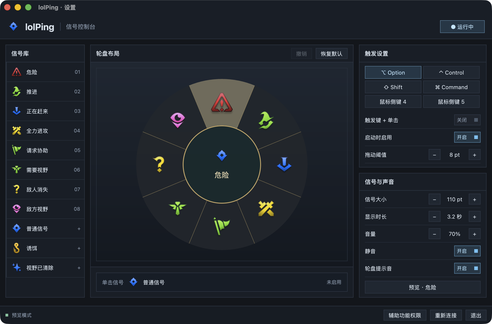
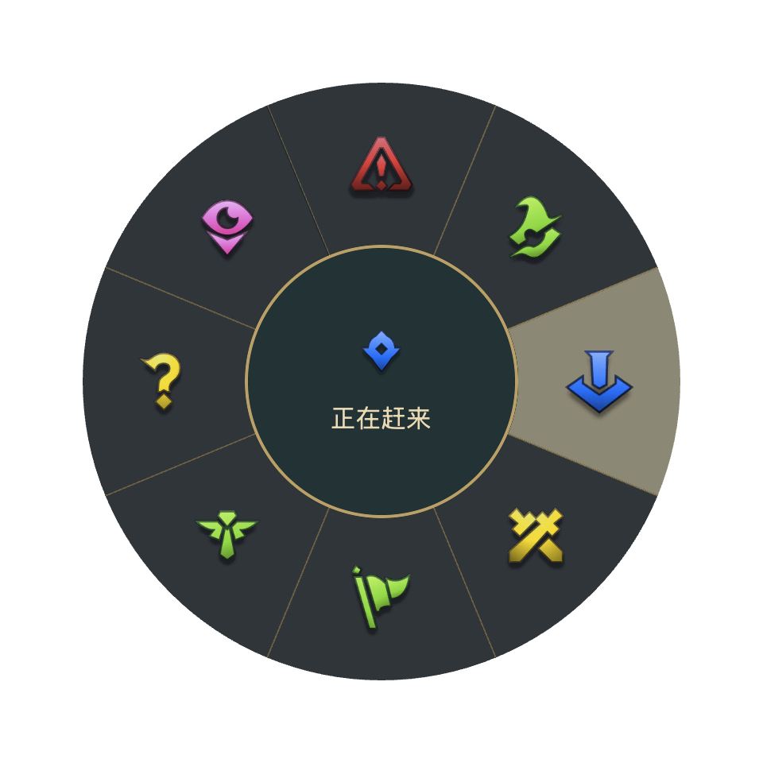

<div align="center">
  
  <h1>lolPing Native</h1>
  <p>把熟悉的信号轮盘带到桌面。按住、拖动、松开，用图标和声音表达意图。</p>
  <p>
    <a href="https://github.com/class-undefined/lolping-native/releases/latest">下载安装包</a> ·
    <a href="#快速上手">快速上手</a> ·
    <a href="#从源码构建">从源码构建</a>
  </p>
</div>

[](https://github.com/class-undefined/lolping-native/actions/workflows/native.yml)
[](https://github.com/class-undefined/lolping-native/releases/latest)
[](LICENSE)

Rust + GPUI 原生桌面应用，支持 Windows x86_64、Windows ARM64 和 Apple 芯片 Mac。安装包包含主程序、输入助手、图标和音效，使用时无需安装 Rust、Python、Node.js、Electron、WebView 或 Visual C++ 运行库。



*真实应用截图，取自 macOS 预览模式。Windows 共用相同界面，触发键名称和系统托盘按平台适配。*

## 下载与安装

打开 **[GitHub Releases](https://github.com/class-undefined/lolping-native/releases/latest)**，在 Assets 中按系统和处理器选择安装包。

| 你的设备 | 下载文件 | 安装方式 |
| --- | --- | --- |
| Windows，Intel / AMD 64 位 | `lolPing-Native-<版本>-windows-x86_64-setup.exe` | 双击安装，完成后启动 |
| Windows，ARM64 / Snapdragon | `lolPing-Native-<版本>-windows-aarch64-setup.exe` | 双击安装，运行原生 ARM64 程序 |
| Mac，M1 / M2 / M3 / M4 等 Apple 芯片 | `lolPing-Native-<版本>-arm64.dmg` | 将应用拖入 Applications |

不确定 Windows 架构时，查看“设置 → 系统 → 系统信息 → 系统类型”。`x86_64` 也称 `x64` 或 `AMD64`；`aarch64` 也称 `ARM64`。

Windows 安装包按当前用户安装，不要求管理员权限，并创建开始菜单入口。安装后直接打开设置，默认启用 Alt 触发。ZIP 是便携包，需完整解压，再运行其中的 `lolping-native.exe`，不要单独移动 EXE。

macOS 首次运行时，在设置页点击“辅助功能权限”，授权后点击“重新连接”。关闭设置窗口后，应用仍在菜单栏或系统托盘运行。

系统要求：Windows x86_64 为 Windows 10 1809 或更新版本；Windows ARM64 为 Windows 11；macOS 为 12 或更新版本。Windows 需要可用的 DirectX 11 图形环境。当前安装包尚未进行 Windows 代码签名或 Apple 公证，系统可能显示来源确认。

## 快速上手

1. 打开 lolPing。确认底部显示“输入助手已连接”。
2. 按住 **Alt**（Mac 为 **Option**），按下鼠标左键并拖向所需信号。
3. 在目标方向松开鼠标，桌面上显示信号并播放音效。拖回中心、按 Esc 或右键可取消。

<p align="center">
  
</p>

轮盘保留八个方向和中心取消区域。设置中可选择其他修饰键、鼠标侧键，以及“触发键 + 单击”模式。

| 操作 | Windows | macOS |
| --- | --- | --- |
| 暂停 / 恢复，全局生效 | `Ctrl+Alt+P` | `⌃⌥P` |
| 打开设置，应用快捷键 | `Ctrl+,` | `⌘,` |
| 撤销轮盘编辑 | `Ctrl+Z` | `⌘Z` |
| 退出应用 | `Ctrl+Q` 或托盘菜单 | `⌘Q` 或菜单栏 |

## 调整你的轮盘

- **拖入信号**：从左侧信号库拖到轮盘扇区。目标信号已在轮盘上时，两处交换。
- **重新排序**：在轮盘内拖动信号，其他信号依次让位。
- **撤销和取消**：点击“撤销”恢复上一次布局；拖到中心或轮盘外、按 Esc 可取消当前拖动。
- **点击放置**：点击信号库中的信号试听并选中，再点击扇区放置。
- **设置单击信号**：把信号拖到轮盘下方的“单击信号”栏。
- **调节反馈**：修改信号大小、持续时间、音量、静音、轮盘提示音和触发方式。修改后自动保存。

“恢复默认”会同时重置轮盘和单击信号，也支持撤销。

## 功能与适用范围

| 功能 | 当前行为 |
| --- | --- |
| 11 种信号 | 危险、推进、正在赶来、全力进攻、请求协助、需要视野、敌人消失、敌方视野、普通信号、诱饵、视野已清除 |
| 原生动画与音效 | 图标弹出、扩散环、全力进攻双图组合，以及原有 WAV 音效 |
| 桌面悬浮层 | 透明、置顶、鼠标穿透，每个显示器独立窗口 |
| 多显示器 | 检测显示器变化，Windows 按所在屏幕缩放换算坐标；macOS 支持跨 Space |
| 后台控制 | 菜单栏 / 系统托盘打开设置、暂停或恢复、退出 |
| 本地设置 | 自动保存、导入旧版支持的字段、限制重复运行 |

适用于普通桌面和窗口模式。游戏独占全屏、受保护的画面和以更高权限运行的目标程序，可能限制悬浮层或输入处理；游戏场景优先使用无边框窗口模式。

当前仍为原生预览版，尚未实现房间、联网同步、自动更新、表情、自定义图片、开机启动和任意快捷键编辑。Electron 完整版见上游 [darrenprx/lolPing](https://github.com/darrenprx/lolPing)。

## 配置与故障排查

配置独立保存，不修改旧版文件：

| 平台 | 路径 |
| --- | --- |
| Windows | `%APPDATA%\lolPing-native\settings.json` |
| macOS | `~/Library/Application Support/lolPing-native/settings.json` |

首次运行会尝试从相邻的 `lolPing/settings.json` 导入支持的字段。不支持的触发键恢复为 Alt / Option，旧版房间和表情字段不会导入。

| 现象 | 处理方式 |
| --- | --- |
| 关闭窗口后找不到应用 | 从 Windows 系统托盘或 macOS 菜单栏打开设置 |
| 输入助手断开 | 点击“重新连接”；Mac 先检查辅助功能权限 |
| 没有声音 | 检查静音开关、音量和系统输出设备 |
| 提示缺少素材或助手 | 使用完整安装包重新安装；便携版重新完整解压 |
| 触发键冲突或输入异常 | 暂停应用，退出旧版 lolPing 或其他占用相同触发键的工具 |
| 安装包无法运行 | 核对系统要求与 CPU 架构，从 Release 重新下载对应安装包 |

使用真实输入时，请退出另一版本的 lolPing，避免两个程序同时拦截触发键。

## 自动构建与 Release

每次推送、Pull Request 和手动运行，都会执行 [Native builds](https://github.com/class-undefined/lolping-native/actions/workflows/native.yml)。Windows x86_64 与 ARM64 分别在对应架构的 Windows 运行器上构建和测试；macOS 使用 Apple 芯片运行器。

向 `main` 推送后，三项平台任务必须全部成功，才会创建 GitHub Release。Release 标签使用 `v<版本>+build.<运行编号>`，保留每次发布的独立下载文件，并将最新通过验收的构建标记为 Latest。失败或落后于 `main` 的构建不会替换最新 Release。

Release 包含三平台安装包和 ZIP、`SHA256SUMS.txt`，以及两个 Windows 验收报告。发布过程先上传到草稿，全部文件到齐后再公开。Actions Artifacts 同时保留 14 天，Release 下载文件长期保留。

Windows 发布前自动完成以下验收：

- 检查主程序与输入助手的 PE 架构，确认没有外部 Visual C++ 运行库依赖。
- 安装到含中文的临时目录，在独立配置目录和仅含系统目录的 PATH 下启动。
- 核对 29 个素材，解码 WAV 文件，启动真实系统输入钩子。
- 运行安装后的 GUI 冒烟测试，检查托盘、悬浮窗、轮盘、编辑器拖拽、撤销和配置保存。
- 检查便携包，卸载安装版，并生成与安装包 SHA-256 绑定的验收报告。

CI 不输出声音，音频文件会单独解码检查。真实音频输出、不同显示器组合和游戏内覆盖效果仍取决于设备与系统环境。

## 从源码构建

以下工具仅供开发使用，安装发行版不需要这些工具。需要 Rust 1.94.1、Python 3.9 或更新版本。GPUI 固定为 0.2.2，依赖由 `Cargo.lock` 锁定。

### macOS

安装 Xcode 命令行工具，在项目根目录运行：

```bash
sh native/hook-helper/build.sh
cargo run --locked -p lolping-native
sh native/gpui/dmg.sh
```

DMG 脚本生成 `.app`、ZIP 和 DMG，并校验临时签名与镜像。已有应用包时，可用 `sh native/gpui/dmg.sh --skip-build` 跳过编译。

### Windows

安装 Visual Studio Build Tools 的“使用 C++ 的桌面开发”和 Windows SDK。ARM64 构建还需 ARM64 C++ 工具。打包需要 [Inno Setup 6](https://jrsoftware.org/isinfo.php)。

打开目标架构对应的 Visual Studio Developer PowerShell，再切换到项目根目录。x86_64 示例：

```powershell
./native/hook-helper/build.ps1 -Architecture x64
cargo run --locked -p lolping-native
python native/gpui/bundle_windows.py --arch x86_64
python native/gpui/verify_windows.py --arch x86_64
```

在 Windows ARM64 开发环境中，把上面的 `x64` 改为 `arm64`，把 `x86_64` 改为 `aarch64`。主程序和输入助手必须使用同一架构；打包脚本会检查这一点。

如果找不到 Windows 着色器编译器，设置路径后再构建：

```powershell
$fxc = Get-ChildItem "${env:ProgramFiles(x86)}\Windows Kits\10\bin\*\x64\fxc.exe" |
  Sort-Object FullName -Descending | Select-Object -First 1
$env:GPUI_FXC_PATH = $fxc.FullName
```

依据：[GPUI 0.2.2 构建脚本](https://docs.rs/crate/gpui/0.2.2/source/build.rs)、[GitHub Windows ARM64 运行器](https://docs.github.com/en/actions/reference/runners/github-hosted-runners)。所有打包产物位于 `release/native/`。

### 测试与预览

先构建并运行输入助手测试（macOS 为 `native/hook-helper/build/helper_tests`，Windows 加 `.exe`），再执行：

```bash
cargo fmt --all --check
cargo test --locked -p lolping-native
cargo clippy --locked -p lolping-native --all-targets -- -D warnings
cargo run --locked -p lolping-native -- --smoke-test
```

GUI 测试需要已登录的图形会话。正常测试包含音效播放；没有音频设备时可追加 `--mute`。

```bash
cargo run --locked -p lolping-native -- --preview
```

预览模式使用模拟助手和临时设置，不读取真实键鼠输入，也不写用户配置。README 截图由这个模式生成；可用 [截图脚本](docs/capture-product.swift) 重新捕获本应用窗口。

## 项目结构与来源

- `native/gpui/`：Rust 应用、GPUI 界面、平台层、安装验收和发布脚本。
- `native/hook-helper/`：C++ 输入助手与测试。
- `assets/`：11 种信号使用的图标和音效。
- `docs/images/`：真实产品截图。
- [原生迁移记录](docs/native-migration.md)：上游分析、实现说明和体积测量。

项目源自 Danrui Meng 的 [darrenprx/lolPing](https://github.com/darrenprx/lolPing)，保留 MIT [LICENSE](LICENSE)。上游提交及迁移范围见 [NOTICE.md](NOTICE.md)。

信号图标、音效和衍生应用图标归 Riot Games 所有，不包含在 MIT 代码许可证内。本项目与 Riot Games 没有隶属或赞助关系。
